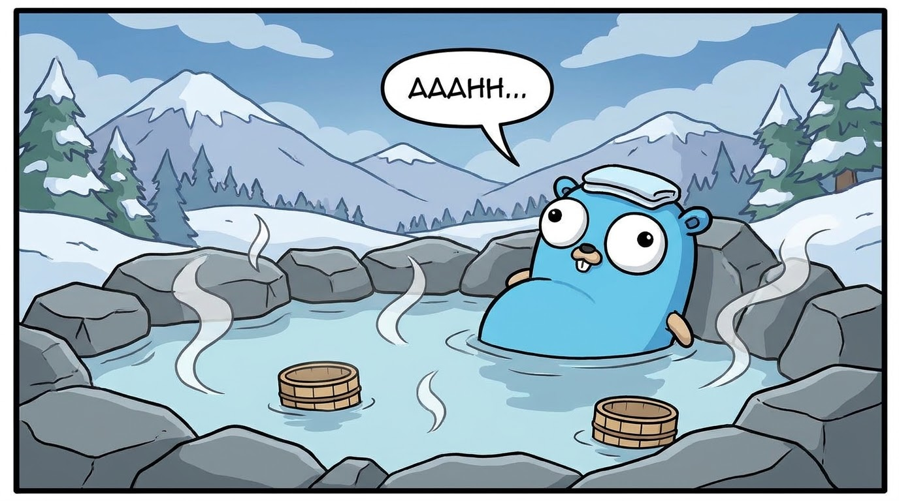

# GoSPA



Serve a built single-page app, and the files of a public folder, from a
Go program.

A build tool such as Vite turns a single-page app into one page,
`index.html`, and a folder of scripts, styles and fonts. The browser
loads the page once, and the app's own router shows a screen for each
address. Go's `http.FileServer` can send these files, but it lists
folders, sends hidden files such as `.env`, sets no cache rules and
cannot send the page for an address the app routes. GoSPA adds those
rules.

If you know Laravel, GoSPA does the job Nginx does in front of a
Laravel app: it sends the app for every address that names no file,
and serves the `public` folder file by file.

The guide is at <https://docs.gopherium.org/files/serving/>.

## Serving a built app

```go
//go:embed all:dist
var dist embed.FS

build, err := fs.Sub(dist, "dist")
if err != nil {
	return err
}
admin, err := gospa.App(build, gospa.AppOptions{
	Meta: []gospa.Meta{{Name: "api-root", Content: "/api/"}},
})
if err != nil {
	return err
}
mux.Handle("/admin/", http.StripPrefix("/admin", admin))
```

`App` fails when the build holds no `index.html`. Then it answers:

| The path | The answer |
| --- | --- |
| a file of the build | the file |
| `index.html` | the page |
| under `assets/`, no file | not found |
| anywhere else, no file | the page |

The page is read again each time it is sent. So a build read from
disk with `os.DirFS` shows a new build without a restart. An embedded
build, as above, changes only when the program is built again and
restarted.

### How long a browser keeps a file

A hashed file is kept for `HashedMaxAge` without asking, one year when
it is zero, and `App` fails when it is below one second. A hashed file
is a file under `assets/` whose name ends in a dash, 8
letters, digits, dashes or underscores, and an extension, as Vite names
`assets/index-DWLUpakq.js`. Its name changes whenever its content does.

The page and every other file get `no-cache`. The browser keeps them
but checks each one on every load, which costs a 304 with no body while
nothing changed. A file with a date is checked by its date. A file with
no date, as every embedded file is, is checked by a tag of the bytes
sent, worked out on every request. A file with no date that cannot seek
has nothing to be checked by, so the browser gets it again on every
load. The page is checked by a tag of the bytes sent, values included.

A name such as `assets/my-settings.js` looks hashed too. Vite writes no
such name under `assets/` unless your project has `public/assets/`.

### Server values in the page

Each `Meta` becomes a meta element right where the head opens:

```html
<head><meta name="api-root" content="/api/">
```

The app reads it with
`document.querySelector('meta[name="api-root"]').content`. Names and
values are escaped. `App` fails on a value with no name or a name given
twice.

## Serving a public folder

```go
root, err := os.OpenRoot("uploads")
if err != nil {
	return err
}
mux.Handle("/media/", http.StripPrefix("/media", gospa.Files(root.FS(), gospa.FilesOptions{})))
```

`Files` sends each file by its path with `no-cache`. A missing file and
a folder answer not found, and a folder's `index.html` is sent only
when asked for by name. Use `os.OpenRoot` for a folder on disk, since
unlike `os.DirFS` it never follows a link out of the folder.

An uploaded HTML or SVG file can run scripts on your site. Serve
uploads from another domain, or check what people upload.

## Rules both share

- Only GET and HEAD are answered. Any other method gets 405.
- A path segment that starts with a dot, such as `.env` or `.git`,
  answers not found. `.well-known` is the one exception.
- A segment that holds a tilde or ends in a dot or a space answers not
  found, since Windows reads `GIT~1` as `.git`.
- A path with an empty segment, such as `//app.js`, answers not found.
- Ranges and checks work as `http.ServeContent` answers them. A file
  that cannot seek, such as one inside a zip, gets the whole file when
  asked for several ranges.
- The type comes from the extension, by GoSPA's own table, the same on
  every system. An extension it does not know gets
  `application/octet-stream`, so the browser downloads the file. Every
  file, page and plain not found answer carries
  `X-Content-Type-Options: nosniff`, so the browser never guesses a type
  from the bytes.
- `NotFound` replaces the plain 404 answer.

GoSPA serves the path it receives, so strip a prefix with
`http.StripPrefix`, as above.

The table knows `html`, `htm`, `css`, `js`, `mjs`, `json`, `map`,
`webmanifest`, `txt`, `xml`, `svg`, `png`, `jpg`, `jpeg`, `gif`,
`webp`, `avif`, `ico`, `woff`, `woff2`, `ttf`, `otf`, `wasm`, `pdf`,
`zip`, `mp3`, `m4a`, `wav`, `ogg`, `flac`, `mp4` and `webm`.

## Testing

`go test ./...` runs the unit tests and the fuzz seeds. The scenarios
sit in `features/`, a module of their own, run with
`cd features && go test ./...`.

## License

Apache-2.0.
